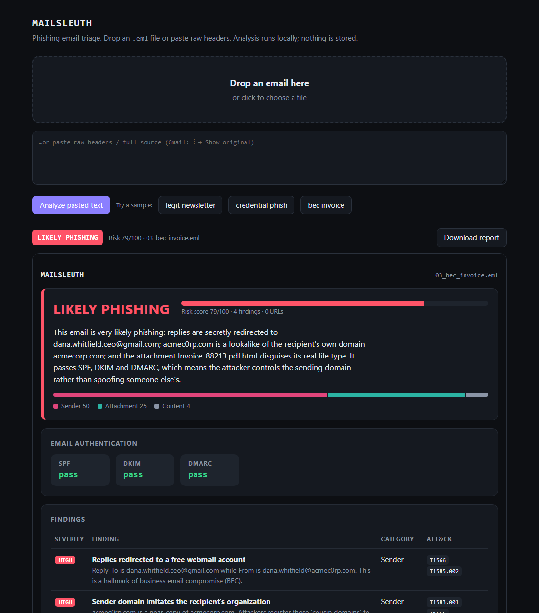
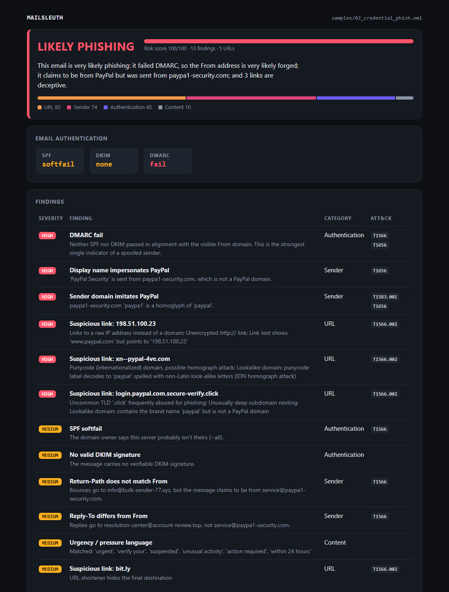
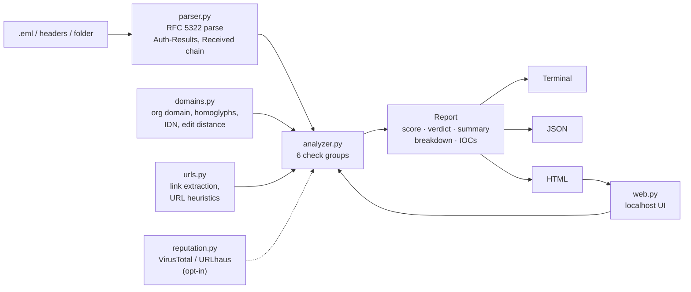

<div align="center">

# MailSleuth

**Phishing email triage for SOC analysts. Drop in an email, get a verdict you can defend.**

[](https://github.com/BlazeXYZ/mailsleuth/actions/workflows/tests.yml)




</div>

---

## Table of contents

1. [The problem](#the-problem)
2. [What MailSleuth does](#what-mailsleuth-does)
3. [Quick start](#quick-start)
4. [Demo: three emails, three stories](#demo-three-emails-three-stories)
5. [Detection specification](#detection-specification)
6. [Scoring model](#scoring-model)
7. [MITRE ATT&CK mapping](#mitre-attck-mapping)
8. [Architecture](#architecture)
9. [Output formats](#output-formats)
10. [Key design decisions](#key-design-decisions)
11. [Security of the tool itself](#security-of-the-tool-itself)
12. [Testing and CI](#testing-and-ci)
13. [Limitations and roadmap](#limitations-and-roadmap)
14. [Legal and ethical use](#legal-and-ethical-use)

---

## The problem

Phishing is consistently among the most common initial-access vectors in breach reports. Many organizations give staff a "Report phish" button, and each report lands in a SOC analyst's queue. For each one, the analyst has to:

1. Open the raw source and read dozens of headers written for machines, not humans.
2. Find the authentication results and work out what `dmarc=fail (p=NONE)` means for *this* message.
3. Compare the visible sender with the envelope sender, the reply address and the signing domain.
4. Hover over every link and check where it really goes.
5. Look at attachments without opening them.
6. Write up a verdict, pull out indicators to block, and close the ticket.

That takes 5–15 minutes per email. The work is repetitive, and it is easy to get wrong when you're tired. A missed business email compromise (BEC) can cost a company a wire transfer.

**MailSleuth automates steps 1–6** and returns a verdict with its reasoning, so the analyst spends their time on judgment instead of parsing.

## What MailSleuth does

Give it an `.eml` file, raw headers, or a whole folder. You get back:

| Output | Why it matters |
|---|---|
| **Verdict + 0–100 risk score** | Lets you triage the queue in seconds: LIKELY PHISHING, SUSPICIOUS or LIKELY LEGITIMATE |
| **Plain-English summary** | *"This email is very likely phishing: it claims to be from PayPal but was sent from paypa1-security.com…"* You can paste it straight into a reply to the employee who reported it |
| **Findings with severity + MITRE ATT&CK IDs** | Every conclusion can be traced to evidence and expressed in a shared vocabulary |
| **Score breakdown by category** | Shows *why* the score is high: authentication, sender identity, links or attachments |
| **Defanged IOC list** | URLs, domains, IPs, addresses and SHA-256 hashes, ready for a blocklist request or threat-intel search |
| **HTML / JSON / terminal reports** | A human-readable ticket attachment, machine-readable SOAR input, or quick CLI triage |

It runs as a **CLI** or as a **local drag-and-drop web app**, uses **only the Python standard library**, and makes **no network calls** unless you explicitly opt in.

## Quick start

```bash
git clone https://github.com/BlazeXYZ/mailsleuth.git
cd mailsleuth

# Web UI: opens http://127.0.0.1:8000 with built-in samples
python -m mailsleuth serve

# CLI
python -m mailsleuth samples/02_credential_phish.eml
```

It requires **Python 3.11+** and nothing else. Running `pip install .` also gives you a `mailsleuth` command.

<details>
<summary><b>More CLI usage</b></summary>

```bash
# A whole folder, with one HTML report per email
python -m mailsleuth samples/ --html reports/

# JSON for automation (pipe into jq, a SOAR playbook, or a SIEM)
python -m mailsleuth suspicious.eml --json
python -m mailsleuth suspicious.eml --json | jq -r '.iocs.domains[]'

# Headers pasted from stdin; a headers-only input works
python -m mailsleuth - < headers.txt

# Optional reputation lookups (each key is optional; set whichever you have)
export VT_API_KEY=...          # https://www.virustotal.com/gui/my-apikey
export URLHAUS_AUTH_KEY=...    # https://auth.abuse.ch/
python -m mailsleuth suspicious.eml --online --max-urls 4

# Web UI options
python -m mailsleuth serve --port 9000 --no-browser
# Deep link straight to a sample, handy for live demos:
#   http://127.0.0.1:8000/?sample=03_bec_invoice.eml
```

**Getting a real email to test with:** In Gmail, open the message, click ⋮ and choose **Download message**. In Outlook, use **File → Save As → .eml**. Export from the *recipient's* mailbox, because the receiving server is what adds the authentication results.

</details>

## Demo: three emails, three stories

<p align="center"></p>
<p align="center"><sub>Recorded with <a href="https://github.com/BlazeXYZ/termreel">termreel</a> from <a href="docs/demo.reel"><code>docs/demo.reel</code></a>.</sub></p>

The [`samples/`](samples) folder holds three synthetic emails. Each one shows a different idea.

| Sample | Scenario | Verdict | Score | What it demonstrates |
|---|---|---|---|---|
| [`01_legit_newsletter.eml`](samples/01_legit_newsletter.eml) | Retail newsletter | LIKELY LEGITIMATE | 0 | **No false positives.** It has tracking links and a bounce subdomain, and nothing fires. |
| [`02_credential_phish.eml`](samples/02_credential_phish.eml) | Fake PayPal "account suspended" | LIKELY PHISHING | 100 | **Classic spoofing.** DMARC fails, the sender is a `paypa1` homoglyph, a link shows `paypal.com` but points to a raw IP, there's a Cyrillic-"а" punycode domain, a shortener, and a credential form posting to a `.click` domain. |
| [`03_bec_invoice.eml`](samples/03_bec_invoice.eml) | "CEO" asks AP for an urgent wire | LIKELY PHISHING | 79 | **Authentication isn't trust.** It **passes SPF, DKIM and DMARC** and is still caught by the Reply-To to Gmail, the `acmec0rp.com` cousin domain and the `.pdf.html` attachment. |

Sample 3 is the main idea of the project. SPF, DKIM and DMARC answer *"did this really come from the domain it shows?"* They don't answer *"is that domain who you think it is?"* An attacker who registers `acmec0rp.com` passes all three checks. A useful analyzer has to look at identity and intent as well as authentication.

<details>
<summary><b>Terminal output for sample 2</b></summary>

See [`docs/example-terminal.txt`](docs/example-terminal.txt) for the full output, and [`docs/example-output.json`](docs/example-output.json) for the JSON schema.

</details>

<p align="center"></p>

## Detection specification

There are nearly 40 distinct checks in six groups. Severity is **H**igh, **M**edium, **L**ow or **I**nfo.

### 1. Email authentication

| Check | Sev | Logic |
|---|---|---|
| SPF fail / permerror | H | From the receiving server's `Authentication-Results` (RFC 8601), falling back to `Received-SPF`. Downgraded to **M** if ARC passed (see [decision 6](#key-design-decisions)) |
| SPF softfail | M | The domain's SPF record ends in `~all` and this IP isn't listed |
| SPF none / neutral / temperror | L | No usable verdict |
| DKIM fail / permerror | H | The signature didn't verify: the message was altered or the signature forged |
| No valid DKIM signature | M/L | **M** when there's no `DKIM-Signature` header at all |
| DMARC fail | H | Neither SPF nor DKIM passed *in alignment with the visible From domain*. This is the strongest single spoofing signal |
| DMARC none / error | L | The domain publishes no enforceable policy |
| Microsoft `compauth=fail` | M | Exchange Online's composite verdict, reported only when DMARC didn't already fail |
| DKIM signer not aligned with From | M | `dkim=pass header.d=mailer.com` while From is `bank.com`: valid, but someone else's signature |
| No authentication headers | I | The tool says so instead of penalizing. Common when headers come from the sender's Sent folder |

### 2. Sender identity

| Check | Sev | Logic |
|---|---|---|
| Reply-To is free webmail | H | `From: ceo@company.com`, `Reply-To: ceo.private@gmail.com` is a BEC hallmark |
| Reply-To differs from From | M | Any other organizational-domain mismatch |
| Return-Path differs from From | M/L | **L** if DMARC passed, because ESPs such as SendGrid and Mailchimp legitimately use their own bounce domains |
| Display name contains another address | H | `"support@paypal.com" <x@evil.test>` |
| Display name impersonates a brand | H | "PayPal Security" sent from a non-PayPal domain. RFC 2047-encoded names (`=?utf-8?b?…?=`) are decoded first |
| Sender domain is a brand lookalike | H | Homoglyphs (`paypa1`, `micros0ft`, `rn`→`m`), brand-as-a-token (`paypal-security.com`), edit distance 1 for brands of 5+ letters, and **IDN homographs** (punycode decoded, Cyrillic/Greek look-alikes mapped) |
| Cousin of the recipient's domain | H | `acmec0rp.com` sent to `acmecorp.com`: homoglyph-normalized match, or edit distance ≤2 |
| Sender header on behalf of another domain | L | The `Sender:` domain differs from From |
| Message-ID domain differs | L | Only when DMARC didn't pass (ESP mail does this all the time) |

### 3. Header forensics

| Check | Sev | Logic |
|---|---|---|
| Date later than delivery | M | The `Date:` header is more than 15 min after the final `Received:` timestamp, which is impossible unless forged |
| Date backdated | M | More than 24 h before the first `Received:` hop |
| Received timestamps out of order | L | A later hop is stamped more than 5 min before an earlier one, a sign of injected hops |
| Missing Message-ID / Date | L | Mail clients always add them; crude scripts often don't |
| Phishing-kit mailer | L | `X-Mailer` contains PHPMailer, King Phisher or Leaf PHPMailer |
| GoPhish markers | M | `X-Gophish-Contact` or a GoPhish mailer, flagged as *probably an authorized awareness test*. Check before escalating |

### 4. Links

URLs come from `text/plain` bodies, HTML `<a href>` *together with their visible text*, and HTML `<form action>` targets.

| Check | Sev | Logic |
|---|---|---|
| Link text shows a different domain | H | The anchor text says `www.paypal.com`; the href goes to `198.51.100.23` |
| Raw IP host | H | Includes decimal (`http://3405803781/`) and hex obfuscations |
| `user@host` in URL | H | `https://paypal.com@evil.test/` really goes to `evil.test` |
| Punycode host | H | `xn--` labels |
| Brand lookalike in host | H | The same engine as the sender check, e.g. `login.paypal.com.secure-verify.click` |
| URL shortener | M | Hides the final destination |
| Abused TLD | M | `.zip`, `.top`, `.click`, `.xyz` and others |
| Plain `http://` | L | |
| Deep subdomain nesting | L | 5+ labels |
| VirusTotal / URLhaus hit | H/M | Optional, with `--online` |

### 5. Attachments

| Check | Sev | Logic |
|---|---|---|
| Double extension | H | `invoice.pdf.html`, `scan.jpg.exe` |
| Risky type | H | Executables, scripts, `.lnk`, `.iso/.img` (historically used to dodge Mark-of-the-Web warnings), `.html/.svg` (local credential pages), macro Office files, `.one` |
| SHA-256 | — | Always computed for threat-intel pivots |

### 6. Content

| Check | Sev | Logic |
|---|---|---|
| Urgency / pressure language | M/L | 14 whole-word phrases ("suspended", "wire transfer", "within 24 hours"…). **M** at 3 or more matches |

## Scoring model

```
score   = min(100, Σ weight(finding))      weights: High 25 · Medium 10 · Low 4 · Info 0
verdict = LIKELY PHISHING  if score ≥ 60
          SUSPICIOUS       if score ≥ 25
          LIKELY LEGITIMATE otherwise
```

The weights are tuned so that:
- **one** high finding on its own → *suspicious* (25). One red flag deserves a look, not an alarm.
- **three** high findings → *likely phishing* (75).
- low findings, which are often legitimate quirks, need **7** before they reach *suspicious*.

The **breakdown** sums points by category, so you can see that a score of 79 came from "Sender 50 · Attachment 25 · Content 4" rather than from a pile of weak signals. Why additive weights and not machine learning? See [decision 4](#key-design-decisions).

## MITRE ATT&CK mapping

| ID | Technique | Tactic | Triggered by |
|---|---|---|---|
| [T1566](https://attack.mitre.org/techniques/T1566/) | Phishing | Initial Access | Authentication failures, sender mismatches |
| [T1566.001](https://attack.mitre.org/techniques/T1566/001/) | Spearphishing Attachment | Initial Access | Risky attachments |
| [T1566.002](https://attack.mitre.org/techniques/T1566/002/) | Spearphishing Link | Initial Access | Suspicious or known-bad URLs |
| [T1656](https://attack.mitre.org/techniques/T1656/) | Impersonation | Defense Evasion | Brand display names, lookalike and cousin domains |
| [T1583.001](https://attack.mitre.org/techniques/T1583/001/) | Acquire Infrastructure: Domains | Resource Development | Lookalike and cousin domains |
| [T1585.002](https://attack.mitre.org/techniques/T1585/002/) | Establish Accounts: Email Accounts | Resource Development | Reply-To on free webmail |
| [T1036.007](https://attack.mitre.org/techniques/T1036/007/) | Masquerading: Double File Extension | Defense Evasion | `file.pdf.html` attachments |

Header-forensics findings (forged Date, injected hops) deliberately carry **no** tag. No ATT&CK technique describes them accurately, and a wrong tag is worse than none. See [decision 9](#key-design-decisions).

## Architecture



| Module | Lines | Responsibility |
|---|---|---|
| [`parser.py`](mailsleuth/parser.py) | ~200 | Raw bytes → `ParsedEmail`: addresses, `Authentication-Results`, DKIM tags, the Received chain with per-hop delays, the originating IP |
| [`domains.py`](mailsleuth/domains.py) | ~160 | Organizational domains, alignment, Levenshtein distance, homoglyph and IDN normalization, brand and cousin-domain detection |
| [`urls.py`](mailsleuth/urls.py) | ~150 | Link extraction from text and HTML (anchors with visible text, form actions), URL heuristics, defanging |
| [`analyzer.py`](mailsleuth/analyzer.py) | ~390 | Every check, scoring, the plain-English summary, IOC extraction |
| [`reputation.py`](mailsleuth/reputation.py) | ~90 | Optional VirusTotal v3 and URLhaus lookups, with rate-limit handling |
| [`report.py`](mailsleuth/report.py) | ~310 | Terminal, JSON and self-contained HTML rendering |
| [`web.py`](mailsleuth/web.py) | ~190 | Localhost web UI on `http.server` |
| [`__main__.py`](mailsleuth/__main__.py) | ~90 | CLI and the `serve` subcommand |

Data flows one way: **parse → check → score → render**. The checks are pure functions that append `Finding` objects to a list. Adding a detection means writing one function and calling it from `analyze()`. No other code has to change.

## Output formats

**Terminal:** colored, with defanged URLs, for quick triage.

**JSON:** stable keys for automation ([full example](docs/example-output.json)):

```jsonc
{
  "verdict": "LIKELY PHISHING", "score": 79,
  "summary": "This email is very likely phishing: replies are secretly redirected to …",
  "score_breakdown": {"Sender": 50, "Attachment": 25, "Content": 4},
  "authentication": {"spf": "pass", "dkim": "pass", "dmarc": "pass", "raw": [ … ]},
  "findings": [{"severity": "high", "category": "Sender", "title": "…", "mitre": ["T1566", "T1585.002"]}],
  "iocs": {"domains": ["acmec0rp.com"], "ips": ["203.0.113.99"], "emails": [ … ], "sha256": [ … ]},
  "urls": [ … ], "attachments": [ … ], "received_chain": [ … ]
}
```

**HTML:** a single self-contained file with no external requests and no JavaScript, safe to attach to a ticket. It follows the light or dark system theme.

## Key design decisions

Each choice below had a reasonable alternative. [`docs/DESIGN.md`](docs/DESIGN.md) gives the full reasoning, the trade-offs and what would change the decision.

| # | Decision | Instead of | Because |
|---|---|---|---|
| 1 | **Standard library only** | `dkimpy`, `tldextract`, Flask | The tool can run on a locked-down analyst workstation or an air-gapped IR laptop with no `pip install`. It also has zero supply-chain surface, which matters for a *security* tool |
| 2 | **Read the receiver's verdicts, not re-verify** | Re-running SPF/DKIM via DNS | Results are only valid at delivery time. DNS records change, keys rotate, and the sending IP is gone. Re-verification later gives a *different* answer, not a truer one |
| 3 | **Trust only the topmost `Authentication-Results`** | Merge all of them | Senders can inject their own fake `Authentication-Results: dmarc=pass`. The receiving server prepends its own, so the topmost one is the trustworthy one |
| 4 | **Transparent weighted rules** | An ML classifier | An analyst has to defend the verdict, and every point here traces to a named finding. ML needs a labeled corpus I don't have, and it drifts as attackers change. Rules first, then ML as a ranking layer, is how mature tools grow |
| 5 | **Strip comments before parsing auth results** | A plain regex | Gmail writes `arc=pass (i=1 spf=pass dkim=pass …)`, and a naive regex reads those nested results and could turn an SPF *fail* into a *pass* |
| 6 | **Context-aware severities** | Fixed severities | Return-Path mismatch is normal for ESPs when DMARC passes, and SPF fails on forwarding when ARC vouches for it. A noisy tool gets ignored, and that is how real phish slips through |
| 7 | **Offline by default; reputation is opt-in** | Always query VirusTotal | Querying tells third parties what you're investigating and can leak internal URLs. Rate limits also make it slow. Heuristics catch new infrastructure that reputation feeds haven't seen yet |
| 8 | **Defanged output, raw values in JSON** | Raw everywhere | Defanged text can't be clicked by accident in a ticket. Automation needs the real values |
| 9 | **Honest ATT&CK tags only** | Tag everything | Removing a stretched T1070.006 (Timestomp) tag was deliberate. Inaccurate mappings mislead downstream reporting |
| 10 | **Synthetic samples on RFC 5737 IPs** | Real phishing emails | Real samples contain real victims' data and live malicious URLs. Documentation IP ranges can never route anywhere |

## Security of the tool itself

A phishing analyzer parses **attacker-controlled input** by definition, so it has to be hardened:

- **Output encoding:** every value is HTML-escaped before rendering. A display name like `<script>…` is a stored-XSS payload against the analyst otherwise, and a test asserts that reports contain no `<script>`.
- **No JavaScript in reports:** reports are static HTML. The IOC list is a read-only `<textarea>`, not a JS copy button.
- **Sandboxed preview:** the web UI renders reports in `<iframe sandbox>` *without* `allow-scripts`. Adding `allow-same-origin` is safe only *because* scripts are off, and the two together would let a frame escape its sandbox.
- **Localhost only:** the web server binds `127.0.0.1`, never `0.0.0.0`. Python's `http.server` is not meant to face a network.
- **Input limits:** 10 MB max request body, and malformed input returns HTTP 422 instead of crashing the server.
- **No path traversal:** sample files are served from a whitelist of names that exist, never from a user-supplied path. A test covers this.
- **No logging of email content.** No telemetry. Nothing is written to disk unless you ask for `--html`.
- **API keys come from environment variables** and are never written to reports or stored in the repo (`.env` is gitignored).

## Testing and CI

```bash
python -m unittest discover -s tests -t . -v
```

There are **39 tests**, all built on `unittest` (no pytest, which keeps decision 1). GitHub Actions runs them on **Ubuntu and Windows × Python 3.11, 3.13 and 3.14**.

| Area | Examples |
|---|---|
| Parsing | RFC 8601 parsing; Gmail ARC comments; Microsoft `compauth`; a forged auth header *below* the real one; RFC 2047 display names |
| Detection | Every URL heuristic; homoglyph, IDN and cousin domains; Date skew in both directions; GoPhish and PHPMailer; whole-word keyword matching |
| Behavior | Verdict for each sample; no false positives on the legit newsletter; ARC softening; no penalty for missing auth headers; garbage input rejected |
| Outputs | JSON round-trip; HTML contains no `<script>`; IOC exclusions; SHA-256 of a known payload |
| Reputation | **Mocked** HTTP: the rate limit stops further calls, and offline is the default. Tests never hit real APIs |
| Web | Real server on an ephemeral port; upload; path traversal returns 404; malformed input returns 422 |
| Hygiene | No control characters in the source, a regression guard for a real bug (see the changelog) |

## Limitations and roadmap

**Known limitations**, written down on purpose. Knowing where a detector fails is part of building one:

- **Organizational domains** use a short built-in suffix list, not the full [Public Suffix List](https://publicsuffix.org/). `evil.github.io` and `github.io` look like the same organization.
- **"Topmost header" is a heuristic.** The robust approach is to configure your own `authserv-id` and trust only matching headers. Some gateways also add several headers.
- **ARC softening trusts any valid ARC chain.** An attacker can run their own ARC sealer. Production systems keep a list of trusted sealers, and this tool only softens SPF (DMARC failure stays High) to limit the impact.
- **The originating IP** is the oldest public IP in the Received chain, and the sender can forge hops below the first trusted server. The robust approach is to take the IP recorded by *your own* MX.
- **The brand list is small** (14 brands). Substring matching on display names can produce false positives (a person named "Chase").
- **No `.msg` support:** save Outlook messages as `.eml`. No OCR, so text inside images isn't read. No sandbox detonation of links or attachments.

**Roadmap:** PSL support · configurable trusted `authserv-id` · a YAML rule file so analysts can tune weights · bulk mailbox/IMAP mode · redirect-chain following in a sandbox · Sigma-style rule export · a feedback loop that records analyst verdicts to calibrate the weights.

## Legal and ethical use

All samples are synthetic. They use reserved documentation IP ranges ([RFC 5737](https://www.rfc-editor.org/rfc/rfc5737)) and fictional or deliberately misspelled domains. Analyze only email you received or are authorized to investigate. With `--online`, URLs are shared with third-party services, so follow your organization's data-handling policy.

---

<div align="center">

MIT License · Built by <b>BlazeXYZ</b> · See also: <a href="docs/DESIGN.md">Design document</a> · <a href="CHANGELOG.md">Changelog</a> · Part of <a href="https://blazexyz.com">blazexyz.com</a>

</div>
